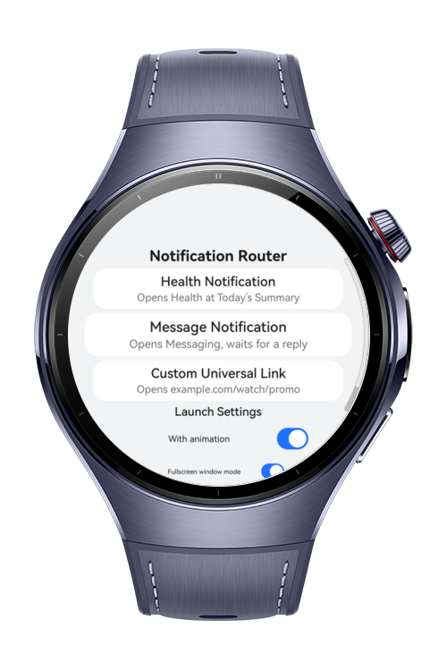
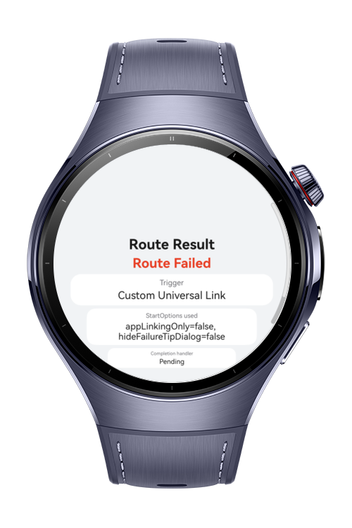
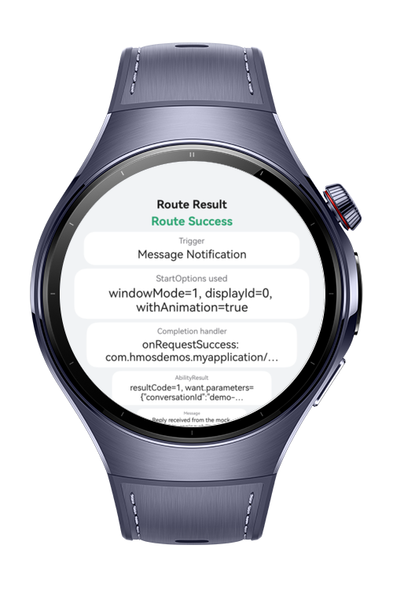

> **Note:** To access all shared projects, get information about environment setup, and view other guides, please visit [Explore-In-HMOS Index](https://github.com/Explore-In-HMOS/hmos-index).

# How to Build Ability Start

This codelab demonstrates **AbilityKit ability-launch and deep-link routing APIs** on a HarmonyOS wearable device. The app implements a **Notification Deep Link Router** that simulates incoming notification taps and a custom universal link, resolves each one into the correct target ability, launches it with a configurable window/animation setup, and reports back the launch status plus any structured result the target ability returns. Every target ability is a lightweight mock `UIAbility` inside the same sample project — there is no real push/notification service, Health app, or Messaging app behind it.

# Preview

<div>
  
  
  
</div>

# Use Cases

- **Trigger a Health Notification route** — tap "Health Notification" to request the `ohos.permission.ACTIVITY_MOTION` permission via `requestPermissionsFromUser()`, then launch the mock `MockHealthAbility` with `startAbility()` and see the resolved page/source parameters on the Route Result screen.
- **Trigger a Message Notification route** — tap "Message Notification" to launch the mock `MockMessagingAbility` with `startAbilityForResult()`; the mock ability replies via `terminateSelfWithResult()`, and the `AbilityResult` (`resultCode` + `want`) is displayed once it comes back.
- **Trigger a Custom Universal Link route** — tap "Custom Universal Link" to open `https://example.com/watch/promo` through `UIAbilityContext.openLink()`, which falls back from App Linking to Deep Linking to the system browser since no App Linking domain is verified for this sample.
- **Configure launch behavior** — toggle `withAnimation`, fullscreen vs. split-primary `windowMode`, `appLinkingOnly`, and `hideFailureTipDialog` from the Route Trigger screen and see each setting reflected in the `StartOptions` / `OpenLinkOptions` summary on the result screen.
- **Track the launch request separately from the ability result** — every route wires up a `CompletionHandler` (`onRequestSuccess` / `onRequestFailure`) so the router can report whether the launch request itself was accepted, independent of the target ability's own lifetime and result.
- **See a simple route status** — the Route Result screen always resolves to one of Route Success, Route Fallback (Browser), Route Failed, or Permission Denied.

# Tech Stack

- **Languages:** ArkTS
- **Frameworks:** HarmonyOS SDK, API version 6.0.1(21)+
- **Tools:** DevEco Studio 6.0.1 or later
- **Libraries & Kits:**
    - `@kit.AbilityKit` — `UIAbilityContext.startAbility()`/`startAbilityForResult()`/`openLink()`/`terminateSelfWithResult()`/`requestPermissionsFromUser()`, `StartOptions`, `OpenLinkOptions`, `AbilityStartCallback`, `CompletionHandler`, `AbilityResult`
    - `@kit.ArkUI` — `ArcList`, `ArcListItem`, `display.getDefaultDisplaySync()`
    - `@kit.PerformanceAnalysisKit` — `hilog`

# Directory Structure

```
how-to-build-ability-start/
├── build-profile.json5
├── AppScope/
│   └── app.json5
└── entry/
    ├── build-profile.json5
    └── src/main/
        ├── module.json5
        ├── ets/
        │   ├── entryability/
        │   │   └── EntryAbility.ets           # UIAbility hosting the Route Trigger page
        │   ├── entrybackupability/
        │   │   └── EntryBackupAbility.ets     # Default backup extension ability
        │   ├── mockability/
        │   │   ├── MockHealthAbility.ets      # Mock target for the Health Notification route
        │   │   └── MockMessagingAbility.ets   # Mock target that replies via terminateSelfWithResult()
        │   ├── model/
        │   │   ├── RouteModels.ets            # RouteTriggerType, RouteStatus, RouteSettings, RouteResultData
        │   │   ├── LinkRouteResolver.ets       # Maps a trigger to a Want or a URL route target
        │   │   └── StartOptionsBuilder.ets     # Builds StartOptions from the in-app settings
        │   ├── service/
        │   │   └── AbilityLaunchService.ets    # Wraps startAbility/startAbilityForResult/openLink + permission checks
        │   └── pages/
        │       ├── Index.ets                  # Route Trigger screen — triggers + settings toggles
        │       ├── MockHealthPage.ets         # UI for MockHealthAbility
        │       ├── MockMessagingPage.ets      # UI for MockMessagingAbility
        │       └── RouteResultPage.ets        # Displays route status, StartOptions, AbilityResult
        └── resources/base/element/
     
```

# Constraints and Restrictions

## Supported Devices

- HarmonyOS wearable Watch 5

# License

**how-to-build-ability-start** is distributed under the terms of the MIT License.
See the [LICENSE](./LICENSE) for more information.